# Monetrax

*Your Money. Your Direction.*

Monetrax is a full-stack personal finance web app for college students. Track your allowance and
expenses across wallets, set budgets, save toward goals, and see where your money goes — with a
retro pixel-art interface.

**Stack:** Python · Flask · Flask-Login · Flask-SQLAlchemy · Werkzeug password hashing ·
SQLite (local) / PostgreSQL (production) · HTML (Jinja) · Tailwind CSS · Vanilla JS · Chart.js ·
Press Start 2P + VT323 fonts · hand-drawn pixel icons

---

## Contents

1. [Quick start](#quick-start)
2. [Configuration](#configuration)
3. [Deploy to Render](#deploy-to-render)
4. [Features](#features)
5. [Financial rules](#financial-rules)
6. [System architecture](#system-architecture)
7. [Database](#database)
8. [Application workflow](#application-workflow)
9. [User flows](#user-flows)
10. [Data flow diagrams](#data-flow-diagrams)
11. [Routes](#routes)
12. [Project structure](#project-structure)
13. [Testing](#testing)
14. [Logo and brand files](#logo-and-brand-files)
15. [Notes before going live](#notes-before-going-live)

---

## Quick start

```bash
python -m venv .venv
source .venv/bin/activate            # Windows: .venv\Scripts\activate
pip install -r requirements.txt
python app.py                        # http://127.0.0.1:5000
```

- The SQLite database (`instance/monetrax.sqlite3`) is created automatically on first run.
- Set `SECRET_KEY` (see [Configuration](#configuration)) so sessions survive restarts.
- Run the tests with `pytest`.

## Configuration

All settings are read from environment variables in `config.py`.

| Variable | Default | Purpose |
|---|---|---|
| `SECRET_KEY` | random on each start | Signs session cookies. **Required in production.** (`MONETRAX_SECRET_KEY` is also accepted.) |
| `DATABASE_URL` | SQLite in `instance/` | PostgreSQL connection string in production. |
| `APP_TIMEZONE` | `Asia/Manila` | Defines "today", weeks (Mon–Sun) and months. |
| `MONETRAX_REQUIRE_SCHOOL_EMAIL` | `true` | Only `.edu` / `.edu.xx` emails can register. |
| `SECURE_COOKIES` | `false` | Set `true` behind HTTPS. |

Other fixed settings: 20 transactions per page, "remember me" cookies last 14 days, and session
cookies are `HttpOnly` and `SameSite=Lax`.

`postgres://` and `postgresql://` URLs are rewritten automatically to `postgresql+psycopg://` for
SQLAlchemy + psycopg 3.

## Deploy to Render

1. Push this project to a GitHub repository.
2. In Render choose **New → Blueprint** and select the repo. `render.yaml` creates a web service and a
   free PostgreSQL database, generates `SECRET_KEY`, sets `SECURE_COOKIES=true`, and connects `DATABASE_URL`.
3. On start, `flask --app app init-db` creates the tables, then Gunicorn serves the app
   (`gunicorn "app:create_app()" --workers 2 --timeout 60`, also in `Procfile`).

---

## Features

| Module | What it does |
|---|---|
| **Auth** | Register, sign in (remember me), sign out; hashed passwords; duplicate-email check; CSRF protection on every form. New accounts get default categories and two wallets (Cash and GCash). |
| **Dashboard** | "Good day, *Name*!", Safe to spend today, wallet balances, Total Allowance / Expenses / Remaining Balance / Savings, income-vs-expense chart (6 months), daily spending trend, category breakdown, recent transactions, budget and savings overviews, Monetrax Insights. |
| **Transactions** | Add, view details, edit, duplicate and delete (with confirmation); search; filter by type, category, wallet and date range; sort by date or amount; pagination; CSV export that respects the current filters. |
| **Wallets** | Cash, GCash, Maya, bank account, prepaid card and other wallets with live balances. Picking a wallet type fills in the wallet name. Every transaction says which wallet it used. **Move money** records cash-ins and withdrawals between wallets without counting them as income or spending. Wallets with history are hidden instead of deleted, and can be restored. |
| **Recurring** | Allowance, rent, load and subscriptions added automatically on schedule (daily, weekly, every 2 weeks, monthly, yearly), with a start date and optional end date. Missed dates are filled in on your next visit, and each schedule posts at most one entry per date. Shows the next date for every schedule and everything due in the next 30 days. Pause, resume, skip the next date, edit or stop. Set up from Transactions → Recurring, or with **Repeat** on any new transaction. |
| **Safe to spend today** | Dashboard figure: money in spendable wallets, minus bills due before your next allowance, divided by the days until it arrives. Without a recurring allowance it plans to the end of the month. |
| **Budget Management** | Weekly or monthly limits per expense category (one per category and period); spent, remaining and % used with progress bars. |
| **Savings Goals** | Target amount, optional target date and starting amount; add or withdraw money; history; weekly pace needed to hit the date. |
| **Analytics & Reports** | Any period (this month, last month, 3/6 months, this year, custom) compared with the previous period. Charts for income vs expenses, spending trend, expense breakdown, monthly savings progress, wallet balances and highest spending categories; category table; income sources; largest expenses; CSV export; print-friendly. |
| **Monthly summary** | Income, expenses, net savings, savings rate, money added to goals, and expense and income breakdowns by category for any month. Printable, and downloadable as CSV. Report amounts are always shown in Philippine pesos (₱). |
| **Notifications** | Budget alerts at **75%**, **90%** and **over 100%**; savings milestones (50%, reached, due within 7 days, overdue); income received from a recurring schedule; read/unread, dismiss, clear read. |
| **Settings** | Profile (school, program, year level), appearance (light, dark or match device), currency, alert toggles, custom categories, password change, **reset financial data** (keeps account, wallets and categories), account deletion. |
| **Pixel UI** | A full retro-game look: chunky pixel frames with hard drop shadows, notched corners, a grid backdrop with CRT scanlines, segmented HP-style progress bars, a spinning coin on Safe to spend, an RPG ▶ cursor in the menu, stepped charts and a pixelated doughnut. Headings use Press Start 2P and body text uses VT323. All 96 icons are hand-drawn 16×16 two-tone pixel art in `static/js/pixel-icons.js` (it replaces Lucide and keeps the same `<i data-lucide="…">` markup). The look lives in `static/css/pixel.css`, which loads last, so deleting that one line in `base.html` brings back the smooth design. |
| **Motion** | Staggered page entrances, numbers that count up, charts that grow in as you scroll to them, an animated sign-in illustration with a self-drawing logo and pointer parallax, a circular reveal when switching themes, a loading bar and busy buttons while pages load, and success messages that dismiss themselves. All of it lives in `static/css/motion.css` and `static/js/motion.js`, and all of it turns off when the device asks for reduced motion. |
| **Light & dark mode** | Sun/moon toggle in the top bar and on the sign-in pages. The choice is saved to the account (follows you to other devices) and in the browser, and applied before the page paints. Colors live as tokens in `static/css/theme.css`. |

Destructive actions (deleting transactions, schedules, budgets, goals, categories and transfers; hiding
wallets; resetting data; deleting the account) ask for confirmation in a Monetrax-styled dialog first.

## Financial rules

| Figure | How it is calculated |
|---|---|
| **Total Income** | Sum of income transactions |
| **Total Expenses** | Sum of expense transactions |
| **Remaining Balance** | Total Income − Total Expenses |
| **Wallet balance** | Starting balance + income − expenses + transfers in − transfers out. The total across wallets can be higher than Remaining Balance by the starting balances you entered. |
| **Safe to spend today** | (spendable wallets now + spent today − bills due before next allowance) ÷ days until it |
| **Total Savings** | Money added to savings goals minus withdrawals. Savings are tracked separately and do not change the Remaining Balance. |
| **Budget level** | ok below 75% · caution from 75% · warning from 90% · over above 100% |

Every figure is calculated from the signed-in student's own records, so editing or deleting a
transaction updates the dashboard, budgets, analytics and alerts immediately.

---

## System architecture

Monetrax is a server-rendered Flask application. Each page is an HTML response built from Jinja
templates; JavaScript only enhances the page (charts, dialogs, animations, theme switching).

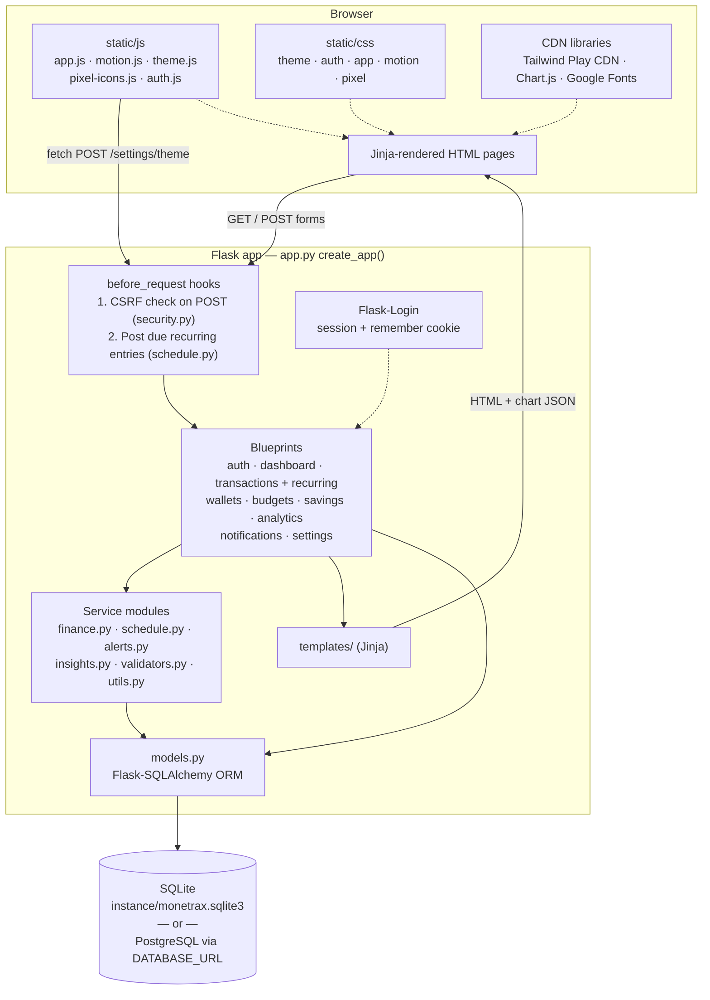

**In production** Render runs the same app under Gunicorn (2 workers) with a managed PostgreSQL
database. Locally, `python app.py` runs Flask's development server with SQLite.

| Layer | Files | Responsibility |
|---|---|---|
| Presentation | `templates/`, `static/` | Pages, reusable macros (`components/`), styling, charts and interactions |
| Routes | `auth.py`, `dashboard.py`, `transactions.py`, `recurring.py`, `wallets.py`, `budgets.py`, `savings.py`, `analytics.py`, `notifications.py`, `settings.py` | One Flask blueprint per area; parse requests, call services, render or redirect |
| Services | `finance.py`, `schedule.py`, `alerts.py`, `insights.py` | Totals, balances, series, budget status, recurring engine, notifications, insights |
| Validation & helpers | `validators.py`, `utils.py`, `security.py` | Form validation, money/date helpers, ownership checks, CSRF, safe redirects, security headers |
| Data | `models.py`, `extensions.py` | SQLAlchemy models, database and login manager setup |

---

## Database

Ten tables. Every row belongs to one user (directly through `user_id`, or through its savings goal
for contributions), and every query is filtered by the signed-in user.

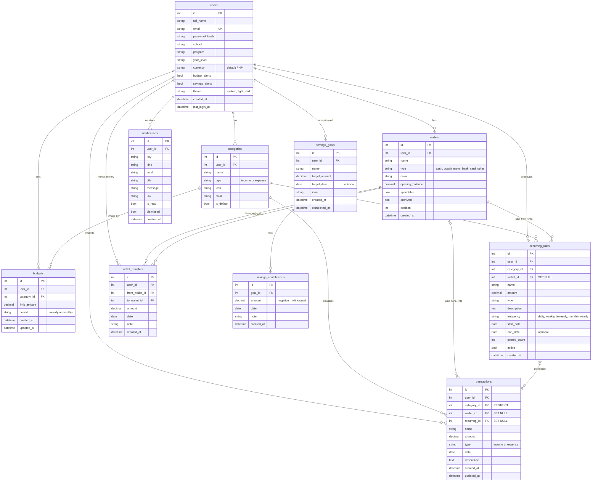

### Constraints and indexes

| Table | Rule |
|---|---|
| `users` | `email` is unique |
| `categories` | unique (`user_id`, `type`, `name`) |
| `wallets` | unique (`user_id`, `name`) |
| `budgets` | unique (`user_id`, `category_id`, `period`) — one weekly and one monthly budget per category |
| `notifications` | unique (`user_id`, `key`) — each alert is created only once |
| `transactions` | index (`user_id`, `date`); **unique (`recurring_id`, `date`)** — a schedule can post only one entry per date |

**Delete behavior (as enforced by the app):**

- Deleting the account removes all of the user's data.
- Default categories can't be deleted, and neither can a category used by transactions or a recurring
  schedule. Deleting an unused custom category also removes its budgets.
- A wallet with transactions, transfers or schedules is hidden, not deleted, so history stays intact.
  An unused wallet is deleted.
- Deleting a recurring schedule keeps the transactions it already posted.
- Deleting a savings goal removes its contributions.

### Schema setup and upgrades

Tables are created on startup with `db.create_all()` (and by `flask --app app init-db`). For existing
databases, `app.py` also runs small, safe upgrades on startup:

- adds the `users.theme`, `transactions.wallet_id` and `transactions.recurring_id` columns if missing;
- adds the `uq_transactions_recurring_date` unique index, **only if no duplicate recurring entries
  exist** (otherwise it logs a warning and changes nothing);
- gives users without wallets the default Cash and GCash wallets, and assigns wallet-less transactions
  to each user's first wallet.

New accounts are seeded with these categories:

| Expense | Income |
|---|---|
| Food, Transportation, Education, School Supplies, Personal Needs, Entertainment, Others | Allowance, Scholarship, Part-time Income, Other Income |

---

## Application workflow

How every request moves through the app:

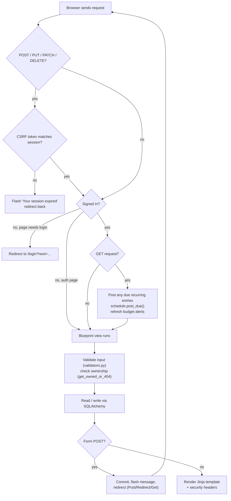

A typical student session:

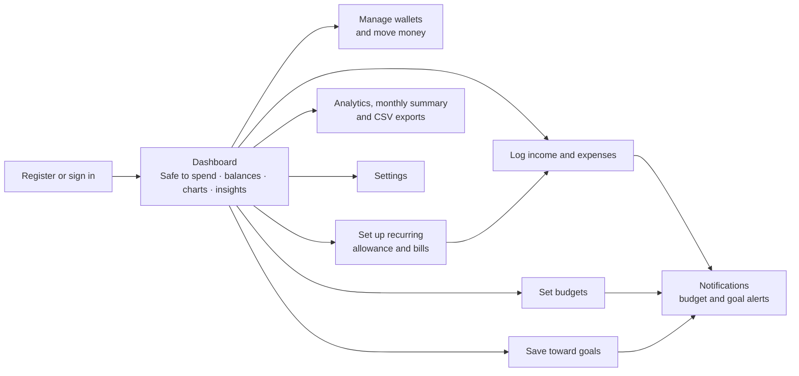

---

## User flows

### Registration

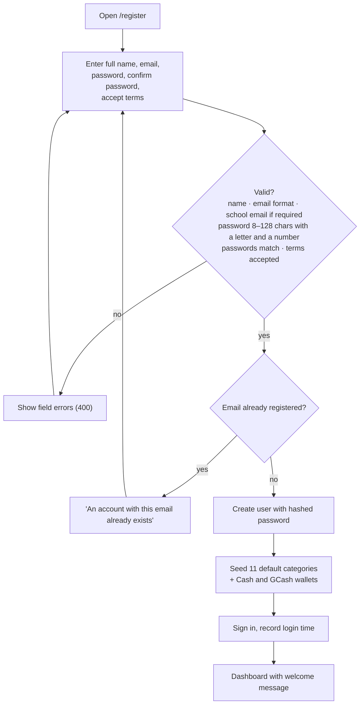

### Login

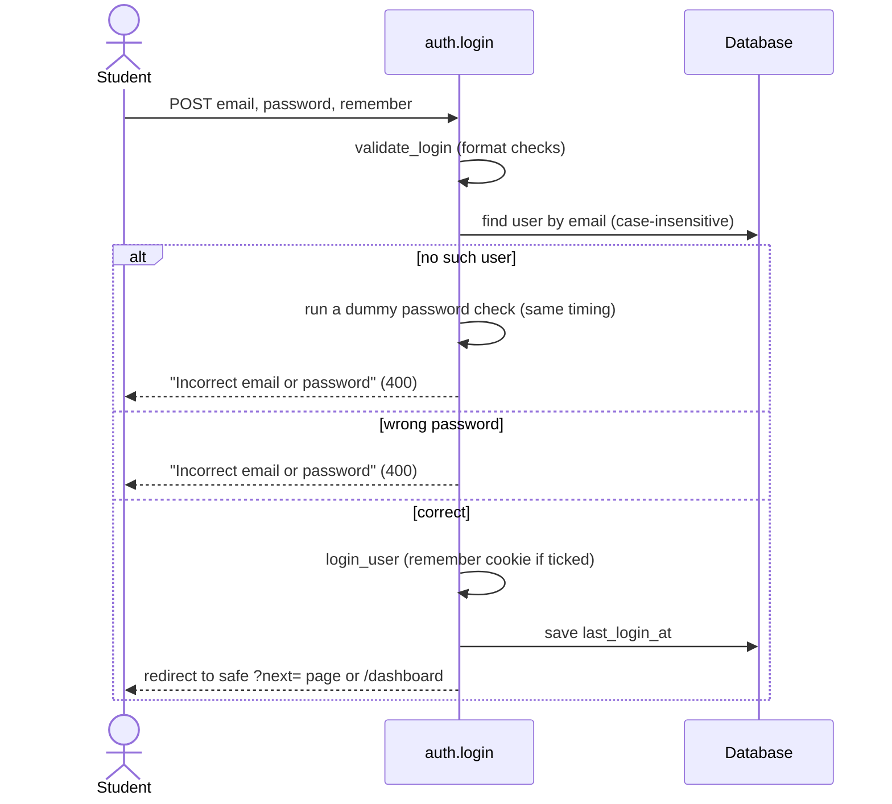

"Forgot password" validates the email and explains that email reset isn't switched on yet; signing
out is a POST to `/logout`.

### Transaction management

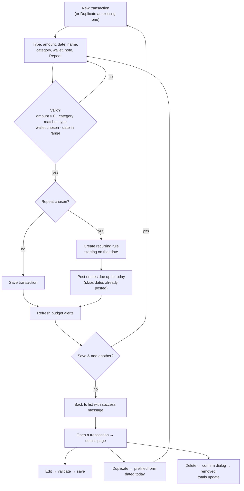

### Recurring schedules

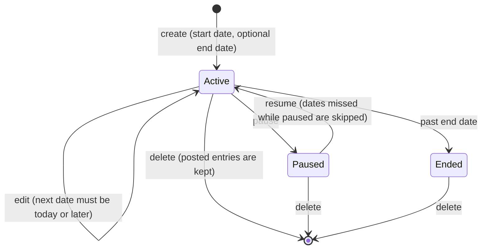

### Wallet management

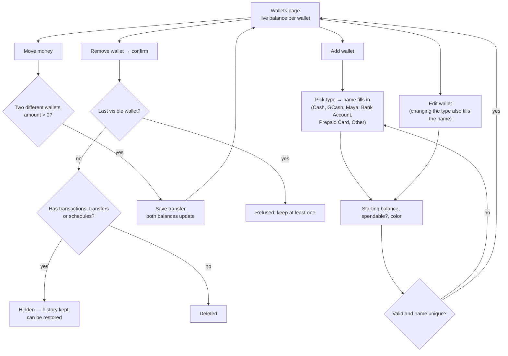

### Budget tracking

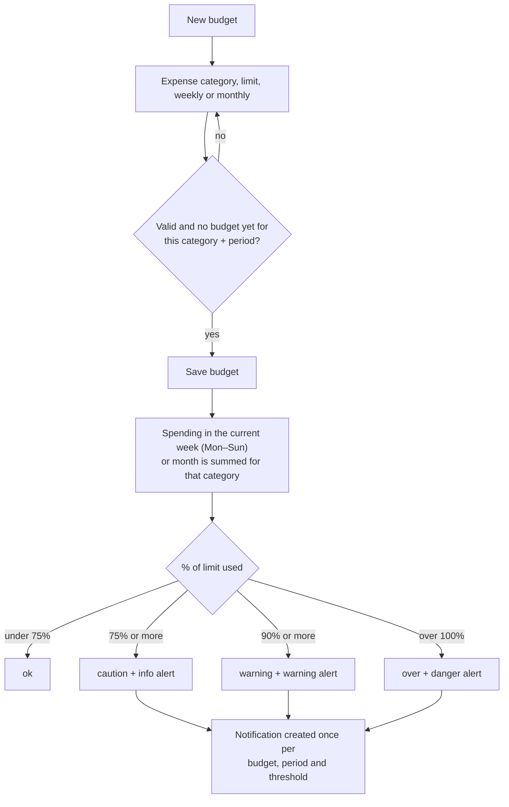

Budget alerts are checked whenever a budget or transaction is saved, when recurring entries are
posted, and when the dashboard loads. They can be turned off in Settings.

### Savings goals

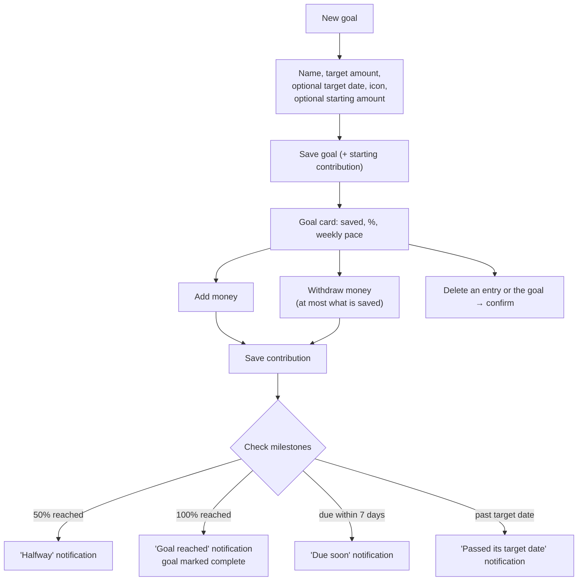

---

## Data flow diagrams

### Level 0 — context

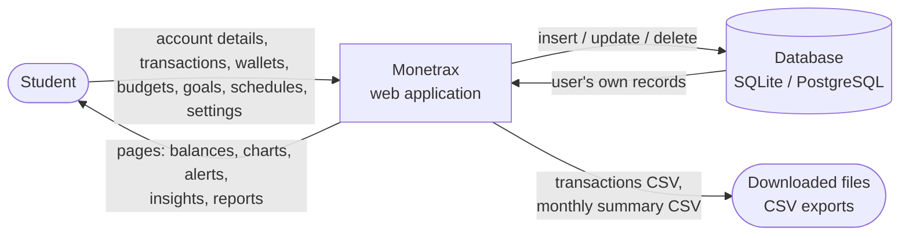

### Level 1 — main processes

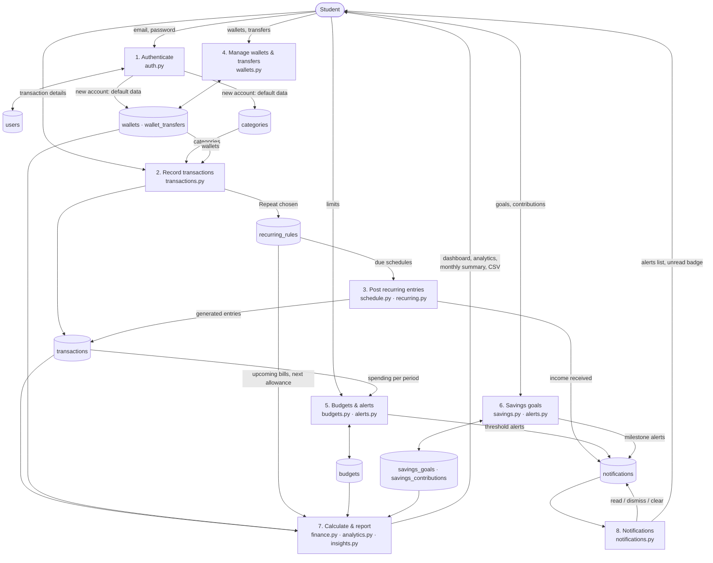

---

## Routes

All routes except the auth pages require sign-in. All state-changing routes are `POST` and need a CSRF token.

| Area | Method | Path | Purpose |
|---|---|---|---|
| Auth | GET | `/` | Redirect to dashboard or login |
| | GET, POST | `/login` · `/register` · `/forgot-password` | Sign in, create account, password help |
| | POST | `/logout` | Sign out |
| Dashboard | GET | `/dashboard` | Overview |
| Transactions | GET | `/transactions/` | List with search, filters, sort, pagination |
| | GET, POST | `/transactions/new` | Create (`?type=`, `?duplicate=<id>`) |
| | GET | `/transactions/<id>` | Details |
| | GET, POST | `/transactions/<id>/edit` | Edit |
| | GET | `/transactions/<id>/duplicate` | Open the new-transaction form prefilled |
| | POST | `/transactions/<id>/delete` | Delete |
| | GET | `/transactions/export.csv` | CSV of the filtered list |
| Recurring | GET | `/transactions/recurring` | Schedules and upcoming 30 days |
| | GET, POST | `/transactions/recurring/new` · `/<id>/edit` | Create / edit a schedule |
| | POST | `/transactions/recurring/<id>/toggle` · `/skip` · `/delete` | Pause/resume, skip next, delete |
| Wallets | GET | `/wallets/` | Balances and recent transfers |
| | GET, POST | `/wallets/new` · `/wallets/<id>/edit` | Create / edit |
| | POST | `/wallets/<id>/hide` · `/wallets/<id>/restore` | Hide (or delete if unused) / restore |
| | GET, POST | `/wallets/transfer` | Move money |
| | POST | `/wallets/transfers/<id>/delete` | Remove a transfer |
| Budgets | GET | `/budgets/` | Budget status |
| | GET, POST | `/budgets/new` · `/budgets/<id>/edit` | Create / edit |
| | POST | `/budgets/<id>/delete` | Delete |
| Savings | GET | `/savings/` | Goals |
| | GET, POST | `/savings/new` · `/savings/<id>/edit` | Create / edit |
| | POST | `/savings/<id>/contribute` | Add or withdraw money |
| | POST | `/savings/<id>/delete` · `/savings/contributions/<id>/delete` | Delete goal / entry |
| Analytics | GET | `/analytics/` | Reports for a period (`?range=`, `?start=&end=`) |
| | GET | `/analytics/monthly` · `/analytics/monthly.csv` | Monthly summary (`?month=YYYY-MM`) |
| Notifications | GET | `/notifications/` | List |
| | POST | `/notifications/<id>/open` · `/toggle` · `/delete` | Open, read/unread, dismiss |
| | POST | `/notifications/read-all` · `/notifications/clear-read` | Bulk actions |
| Settings | GET | `/settings/` | Sections via `?section=` |
| | POST | `/settings/profile` · `/preferences` · `/theme` · `/password` | Update settings |
| | POST | `/settings/categories` · `/settings/categories/<id>/delete` | Custom categories |
| | POST | `/settings/reset-data` · `/settings/delete-account` | Reset financial data / delete account |

---

## Project structure

Everything lives in one project folder. Only `templates/`, `static/`, `tests/` and `instance/` are
subfolders (Flask looks for templates and static files there).

```
Monetrax/
  app.py              app factory + entry point (python app.py / gunicorn "app:create_app()"),
                      startup schema upgrades, recurring posting hook, template filters
  config.py           settings (SQLite locally, PostgreSQL via DATABASE_URL)
  extensions.py       SQLAlchemy + LoginManager
  models.py           User, Category, Transaction, Wallet, WalletTransfer, RecurringRule,
                      Budget, SavingsGoal, SavingsContribution, Notification
  security.py         CSRF, safe redirects, security headers
  validators.py       server-side validation for every form
  utils.py            dates in the app time zone, money parsing/formatting, ownership checks

  finance.py          totals, category breakdowns, time series, budget status, savings pace and
                      progress, monthly summaries, wallet balances, safe to spend today
  schedule.py         recurring engine: next dates, catch-up posting, upcoming bills
  alerts.py           budget threshold (75/90/100%) and savings milestone notifications
  insights.py         rule-based Monetrax Insights

  auth.py             /login /register /forgot-password /logout
  dashboard.py        /dashboard
  transactions.py     /transactions (list, details, create, edit, duplicate, delete, CSV)
  recurring.py        /transactions/recurring
  wallets.py          /wallets
  budgets.py          /budgets
  savings.py          /savings
  analytics.py        /analytics, /analytics/monthly
  notifications.py    /notifications
  settings.py         /settings

  templates/          base.html, layouts/app.html (sidebar shell), components/ (reusable macros),
                      errors/, one folder per page
  static/
    css/              theme.css (color tokens), auth.css, app.css, motion.css, pixel.css (loads last)
    js/               app.js (charts, dialogs, forms), auth.js, theme.js, motion.js, pixel-icons.js
    img/              favicon, touch icon, logo mark
    brand/            logo files (see below)
  instance/           monetrax.sqlite3 (local database, created on first run)
  tests/              pytest suite
  requirements.txt  render.yaml  Procfile  pytest.ini
```

## Testing

```bash
pytest
```

The suite (`tests/`) runs against an in-memory SQLite database (`TestConfig`) and covers:

- **Auth:** registration rules, school email, duplicate emails, login/logout, safe `next` redirects,
  CSRF blocking, protected pages.
- **Modules:** every page renders, balances after add/edit/delete, validation, search/filter/sort,
  per-user data isolation, budgets and threshold notifications, savings goals, analytics and insights,
  notifications, settings, theme saving, startup column upgrade.
- **Wallets & recurring:** balances with transfers, wallet hiding, schedules (including short months and
  leap years), catch-up posting, pause/resume, validation.
- **New features:** no duplicate recurring entries (including the database rule and the safe startup
  migration), transaction details/duplicate/edit/delete, CSV and monthly summary output in ₱,
  analytics charts checked against the database, reset financial data, wallet name auto-fill.

## Logo and brand files

`static/brand/` holds the logo in every form you're likely to need:

| File | Use it for |
|---|---|
| `monetrax-logo.svg` / `monetrax-logo-white.svg` | Logo with name, on light / dark backgrounds |
| `monetrax-logo-tagline.svg` / `monetrax-logo-tagline-white.svg` | Logo with "Your money. Your direction." |
| `monetrax-mark.svg` / `monetrax-mark-emerald.svg` | App icon tile (navy / emerald) |
| `monetrax-symbol-navy.svg` / `monetrax-symbol-white.svg` | The symbol alone, no tile |
| `monetrax-icon-512.png`, `monetrax-icon-192.png` | App stores, social profiles, slides |
| `monetrax-brand-sheet.png` | Overview of all versions |

The symbol is an **M** whose last stroke rises into an arrow: your money, heading in your direction.
The dot is the coin you're tracking. The name is set in Plus Jakarta Sans ExtraBold, converted to
outlines so it looks the same everywhere without the font installed.
Inside the app the logo is redrawn as pixel art on a 16×16 grid with the name in Press Start 2P;
the files above are the smooth originals for print and app stores.

## Notes before going live

- **Database migrations:** tables are created with `db.create_all()`, plus the small startup upgrades
  in `app.py`. As the schema keeps changing, add Flask-Migrate (Alembic) so existing data is migrated safely.
- **Tailwind** loads from its Play CDN. For production, compile it with the Tailwind CLI and serve the CSS.
- **Password reset** asks for an email but doesn't send one yet; connect an email provider to finish it.
- **Terms and Privacy** text in `templates/auth/register.html` is a placeholder.
- Consider rate limiting `/login` and `/register` (e.g. Flask-Limiter).
